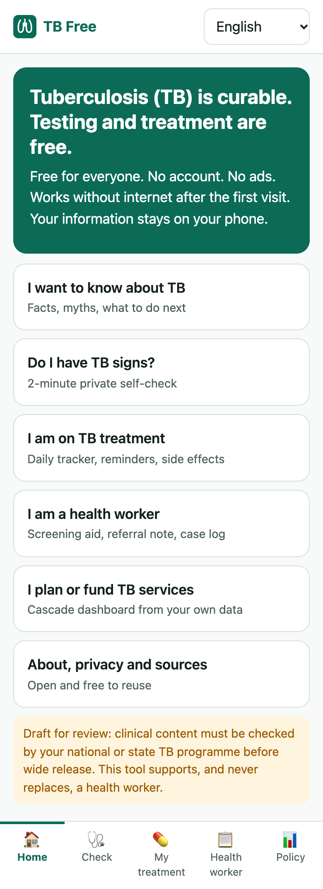
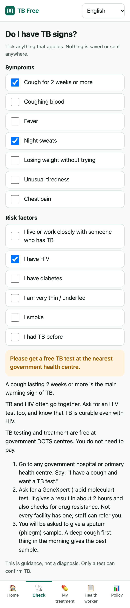
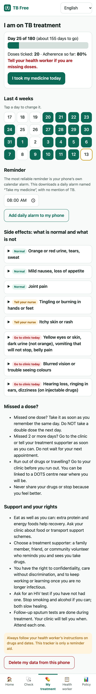

<div align="center">

# TB Free

**A free, offline-first web app for fighting tuberculosis in Nigeria and other high-burden tropical countries.**


[Features](#features) · [Quick start](#quick-start) · [Languages](#languages) · [Architecture](Architecture.md) · [Design](Design.md) · [Mom Test](MOM_TEST.md)

</div>

---

TB Free puts TB information and tools in the hands of the public, patients, frontline health workers and policy makers. There is no account, no advert, no server and no tracking. After the first visit it works with no internet connection, and it can be installed on a phone like a native app.

<p align="center">
  
  
  
</p>

## Features

| Audience | Screen | What it does |
|---|---|---|
| General public | **Learn** | Myths and facts, and the next steps to take if you suspect TB. |
| General public | **Check** | A private two-minute symptom and risk self-check that returns one of four outcomes: urgent, get tested, watch, or low risk. |
| Patients | **My treatment** | Daily dose tracker, a daily alarm file (`.ics`) with the neutral name "Take my medicine", side-effect traffic lights, missed-dose guidance, rights and support. |
| Health workers | **Health worker** | Presumptive-TB screen for adults, children and people living with HIV; case log by code with CSV export; referral note. |
| Policy makers | **Policy** | Load a CSV to see the care cascade, flags by state and editable thresholds. A synthetic sample is built in. |

### Privacy by design

- All data stays in the browser's `localStorage`. Nothing is sent anywhere.
- The daily alarm uses a neutral title so a phone's lock screen does not reveal a TB diagnosis.
- Case records use codes, not names.

## Languages

English, Naijá Pidgin, Hausa, Yorùbá and Igbo. The non-English text covers the main screens and is a **draft pending native-speaker review**.

## Quick start

No build step and no dependencies.

```bash
git clone https://github.com/oyesina/tbfree-V1.git
cd tbfree-V1
python3 -m http.server 8765 --directory app   # then open http://localhost:8765
```

Run the logic tests (Node 18 or later):

```bash
node --test app/tests/
```

### Deploy

Copy the `app/` folder to any static host: GitHub Pages, Netlify, or a ministry server. It must be served over HTTPS (or `localhost`) for the service worker and install prompt to work.

## Repository layout

```
app/                 The PWA (HTML, CSS and vanilla JavaScript)
  logic.js           Pure logic: screening rules, CSV, care cascade, .ics
  content.js         All text and translations
  app.js             Views, routing and storage
  sw.js              Service worker for offline use
  tests/             Unit tests for logic.js
blog-review/         Product walkthrough with screenshots for every feature
MOM_TEST.md          Customer-discovery plan, evidence and verdict
field-sheet.html     Printable interview sheet
Architecture.md      How the system is built
Design.md            Design principles, visual system and accessibility
```

## Documentation

- [Architecture.md](Architecture.md): modules, data flow, storage, offline strategy and testing.
- [Design.md](Design.md): audience, principles, visual system, language and accessibility choices.
- [MOM_TEST.md](MOM_TEST.md): the customer-discovery plan and findings.
- [blog-review/review.md](blog-review/review.md): a screenshot walkthrough of every feature.

## Status and roadmap

TB Free is a **pre-release prototype**. It is not a medical device and does not replace a clinician's advice. Before public release:

- [ ] Clinical review and sign-off by the NTBLCP or a state TB programme.
- [ ] Native-speaker review of Hausa, Yorùbá, Igbo and Pidgin.
- [ ] Verified helpline and facility-locator data from the programme (left out on purpose).
- [ ] Complete the Mom Test in [MOM_TEST.md](MOM_TEST.md). Current verdict: **not passed**, because no real interviews have been done yet.
- [ ] Choose an open-source licence.

## Contributing

Issues and pull requests are welcome, especially from clinicians, TB programme staff and native speakers of the supported languages. Please keep changes dependency-free and keep every user-supplied value escaped before it is rendered.

## Disclaimer

The information in this app is general and educational. It does not diagnose, and the self-check cannot rule TB in or out. Anyone with a cough lasting two weeks or longer, or coughing blood, should go to a health facility. TB testing and treatment are free in Nigeria's public programme.
